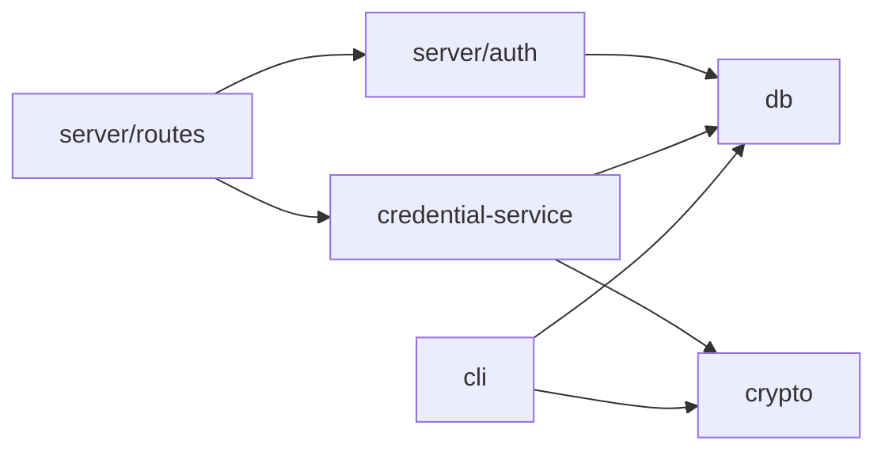
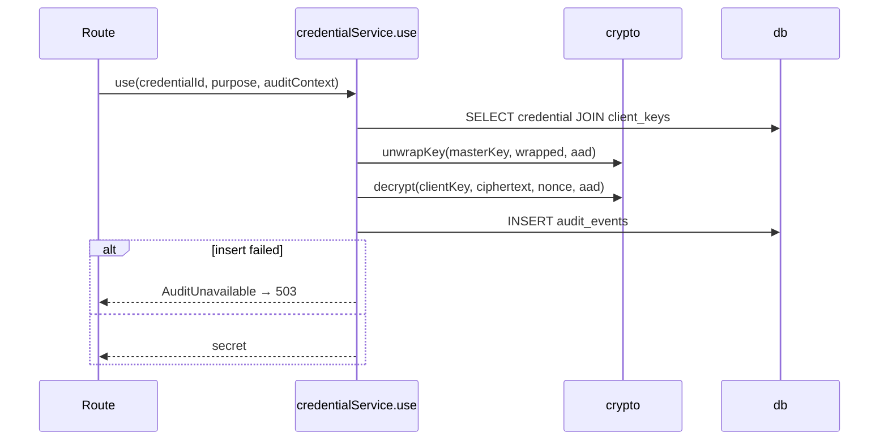
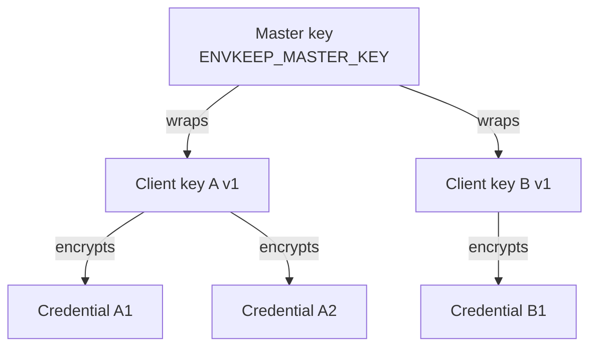
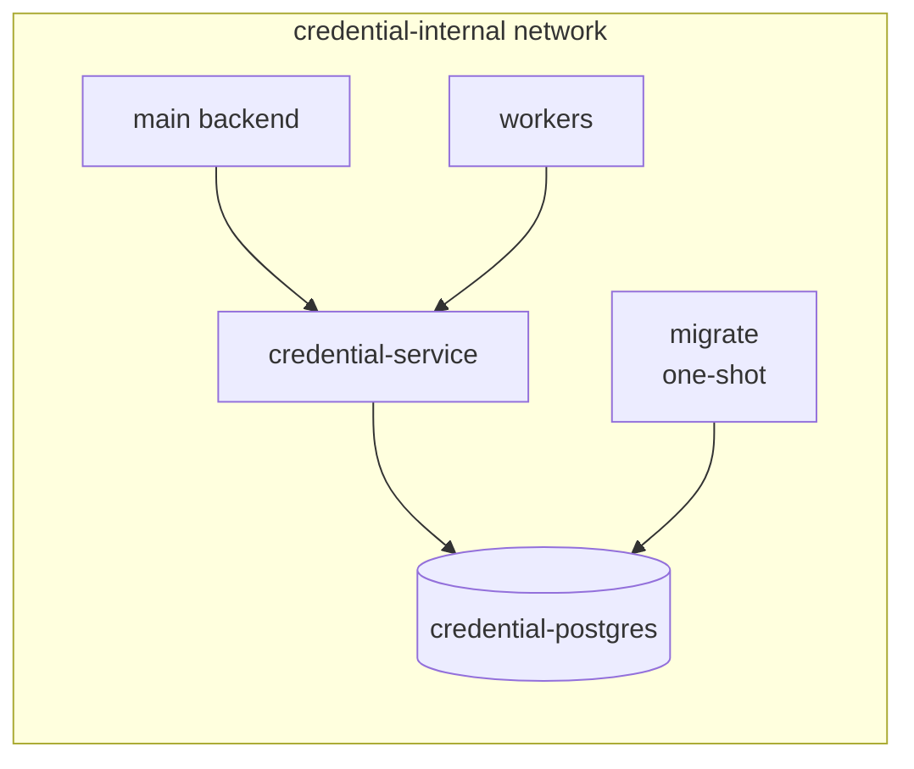

# Design: Credential Service

Implementation design for [srs.md](srs.md). `FR-n`, `NFR-n`, `D-n` refer to the SRS. Architecture decisions are recorded in [adr/](adr/).

## 1. Overview

| Area       | Choice                                                                                    |
| ---------- | ----------------------------------------------------------------------------------------- |
| Runtime    | Node.js 22, TypeScript (strict)                                                           |
| HTTP       | Fastify, built-in JSON schema validation, built-in pino logger                            |
| Database   | PostgreSQL 17, driver `pg`, raw SQL, no ORM ([ADR-0003](adr/0003-raw-sql-without-orm.md)) |
| Migrations | Numbered `.sql` files, own runner in the CLI                                              |
| Crypto     | Node.js `crypto`, isolated pure module                                                    |
| CLI        | `commander` (existing `src/cli`): migrations, service tokens                              |
| Tests      | Vitest + Testcontainers with a real PostgreSQL                                            |
| Deployment | Docker Compose, internal network only                                                     |

## 2. Module Structure

```
migrations/             0001_init.sql, 0002_….sql
src/
  crypto/               pure functions, no I/O: keys, AES-256-GCM, AAD, token generation and hashing
  db/                   pg pool, transactions, SQL queries per table, migration runner
  credential-service/   operations store / use / revoke / history: orchestrate db + crypto + audit
  server/               Fastify app, routes, auth hook, error handler, config
  cli/                  migrate, seed, token issue / revoke / list
  shared/               types shared between server and CLI
```

Migrations live in the top-level `migrations/` directory, not under `src/`: `tsc` does not copy `.sql` files to `dist/`, and the Docker image copies the directory as is.



Rules:

- `crypto` imports nothing from the project and does no I/O, so it is unit-tested in isolation.
- Only `db` contains SQL.
- `server` never calls `crypto` directly; all secret handling goes through `credential-service`.

## 3. Request Handling

### Pipeline

1. **Schema validation** (Fastify JSON schema) → `400`.
2. **Auth hook** (`onRequest`): hash the bearer token, load the token with its permissions and purposes in one query → `401` if missing, unknown or revoked (FR-21, FR-25).
3. **Route handler** checks the permission for the action and, after loading the credential, its provider → `403` (FR-23). For `use`, it checks the purpose → `400` / `403` (FR-8).
4. **Credential service operation** runs and writes the audit event (§3.2).
5. **Error handler** maps errors to `{error: {code, message}}` and writes the audit event for rejected requests (FR-26).

Each request carries an `auditContext` (action, token id, client id, credential id, provider, purpose) filled in step by step, so a rejection at any step produces one event with everything known so far.

### Operations

| Operation | Steps                                                                                                                                                                                                | Audit failure            |
| --------- | ---------------------------------------------------------------------------------------------------------------------------------------------------------------------------------------------------- | ------------------------ |
| `store`   | Generate `credential_id` in the app (needed for AAD). `BEGIN`; `INSERT client_keys … ON CONFLICT DO NOTHING`, then `SELECT` the key; encrypt; `INSERT credentials`; `INSERT audit_events`; `COMMIT`. | Rollback, `503` (FR-29)  |
| `use`     | One `SELECT` of the credential `JOIN client_keys`; unwrap client key; decrypt; `INSERT audit_events`; return the secret only after the insert succeeds.                                              | No secret, `503` (FR-12) |
| `revoke`  | `BEGIN`; `SELECT … FOR UPDATE`; if active, `UPDATE` status, `revoked_at`, `ciphertext = NULL`, `nonce = NULL`; `INSERT audit_events`; `COMMIT`. Already revoked → same body, original `revoked_at`.  | Rollback, `503` (FR-29)  |
| `history` | `SELECT` from `audit_events` by `client_id` with filters, `ORDER BY ts DESC, id DESC`, keyset cursor `(ts, id)`; `INSERT audit_events` for the read itself.                                          | `503`                    |

`INSERT … ON CONFLICT DO NOTHING` makes concurrent first `store` calls for the same client safe: both end up using the same client key.



### Client key caching

The unwrapped client key is not cached. Unwrapping 32 bytes with AES-GCM takes microseconds; `use` latency is dominated by the `SELECT` and the audit `INSERT`. Not caching keeps plaintext keys in memory only for the duration of one request. If NFR-1 is not met, profile first; an in-memory LRU with a short TTL is the fallback.

## 4. Cryptography

### Library (D-7)

- Node.js built-in `crypto` module (backed by OpenSSL): `createCipheriv` / `createDecipheriv` with `aes-256-gcm`, `randomBytes` for keys and nonces, `createHash('sha256')` for token hashes.
- No third-party or custom crypto code.

### Key hierarchy



### Module interface

| Function                                               | Purpose                                 |
| ------------------------------------------------------ | --------------------------------------- |
| `generateKey()`                                        | 32 random bytes                         |
| `encrypt(key, plaintext, aad)`                         | Returns `{ciphertext, nonce}`           |
| `decrypt(key, ciphertext, nonce, aad)`                 | Throws `DecryptionError` on any failure |
| `wrapKey(masterKey, clientKey, aad)`                   | `encrypt` for client keys               |
| `unwrapKey(masterKey, wrapped, nonce, aad)`            | `decrypt` for client keys               |
| `credentialAad(credentialId, clientId, keyVersion)`    | AAD for secrets (FR-4)                  |
| `clientKeyAad(clientId, keyVersion, masterKeyVersion)` | AAD for wrapped keys (D-6)              |
| `generateServiceToken()`                               | `evk_` + base64url(32 random bytes)     |
| `hashServiceToken(token)`                              | SHA-256                                 |

### Nonce (D-5)

- 96-bit (12 bytes) from `randomBytes(12)` for every encryption, stored next to the ciphertext.
- Random 96-bit nonces stay safe up to about 2³² encryptions per key, far above the expected number of credentials per client.

### AAD encoding (D-5)

Fields in fixed order, each as a 4-byte big-endian length followed by the UTF-8 bytes:

| Order | Field         | Value                     |
| ----- | ------------- | ------------------------- |
| 1     | credential_id | UUID, lowercase canonical |
| 2     | client_id     | as received               |
| 3     | key_version   | decimal string            |

Length prefixes make the encoding unambiguous, so `("ab", "c")` and `("a", "bc")` produce different AAD.

The client key wrap (D-6) uses the same encoding with `client_id`, `key_version`, `master_key_version`.

### Authentication tag

- 128-bit GCM tag stored together with the ciphertext.
- Any tag verification failure is a decryption failure (FR-13).

## 5. Service Tokens

- Format: `evk_` + base64url of 32 random bytes (43 chars). The prefix makes tokens detectable in logs, code and chat by secret scanners (gitleaks custom rule `evk_[A-Za-z0-9_-]{43}`).
- Stored as SHA-256 of the full token in `service_tokens.token_hash` with a unique index; lookup is by hash. A slow hash is not needed for 256-bit random tokens (D-16).
- Issued and managed only via CLI:

```
envkeep token issue --name collector --perm use:shopify --perm use:meta_ads --purpose daily_report
envkeep token revoke <token-id>
envkeep token list
```

`issue` prints the plaintext once (FR-22).

## 6. Database

### Schema

Tables as in [SRS §6](srs.md#6-data-model). Additional implementation details:

- `credentials.status` and `audit_events.action` / `outcome` are `text` with `CHECK` constraints.
- `CHECK ((status = 'active') = (ciphertext IS NOT NULL))` guarantees revoked rows have no ciphertext.
- Index `audit_events (client_id, ts DESC, id DESC)` for history; `audit_events (credential_id, ts DESC)` for the credential filter.

### Roles (D-19)

| Role               | Used by         | Privileges                                                                                                                         |
| ------------------ | --------------- | ---------------------------------------------------------------------------------------------------------------------------------- |
| `credential_owner` | Migrations only | Owns schema and tables                                                                                                             |
| `credential_app`   | Running service | `SELECT`, `INSERT`, `UPDATE` on credential and token tables; `SELECT`, `INSERT` on `audit_events`; `USAGE` on its sequence; no DDL |

The service never receives `credential_owner` credentials.

### Append-only enforcement (D-19)

- `credential_app` has no `UPDATE`, `DELETE` or `TRUNCATE` on `audit_events`.
- A `BEFORE UPDATE OR DELETE` row trigger and a `BEFORE TRUNCATE` statement trigger on `audit_events` raise an exception for any role, including `credential_owner`.
- A DB superuser can still bypass this (see SRS §9).

### Migrations

- Files `migrations/NNNN_name.sql`, applied in order, each in its own transaction.
- Applied versions are stored in `schema_migrations (version, applied_at)`.
- `pg_advisory_lock` prevents two runners from applying migrations at the same time.
- Run by `envkeep migrate` as `credential_owner`; migrations are forward-only.

## 7. Logging

- pino via Fastify, JSON to stdout.
- `redact` paths: `req.headers.authorization`, `*.secret`, `*.token`; censored as `[REDACTED]`.
- Request and response bodies are never logged.
- Errors are logged with message and stack only; error objects never carry secret values.
- The `evk_` prefix allows an extra check in tests and log scanning; provider secrets have no common prefix, so the tests search for the actual values (§10).

## 8. Configuration

| Variable             | Required | Description                             |
| -------------------- | -------- | --------------------------------------- |
| `ENVKEEP_MASTER_KEY` | yes      | base64, 32 bytes after decoding (FR-30) |
| `DATABASE_URL`       | yes      | Connection as `credential_app`          |
| `HOST`, `PORT`       | no       | Default `0.0.0.0`, `8080`               |
| `LOG_LEVEL`          | no       | Default `info`                          |

The CLI uses its own `DATABASE_URL` pointing to `credential_owner` for `migrate` and to `credential_app` for token commands. Config is validated at startup; any invalid value stops the process.

## 9. Deployment



- `docker-compose.yml`: services `credential-postgres`, `migrate`, `credential-service`; no `ports` on any service (NFR-3).
- `migrate` runs `envkeep migrate` with `credential_owner` and exits; `credential-service` starts after it completes successfully (`depends_on: condition: service_completed_successfully`). This keeps owner credentials out of the running service.
- Roles and passwords are created by an init script in `docker-entrypoint-initdb.d`.
- `credential-internal` is a named network that the main backend and workers join.
- `ENVKEEP_MASTER_KEY` is passed from the host environment, never committed.
- `docker-compose.override.yml` for local development only: publishes `5432` and `8080` to `127.0.0.1`.

## 10. Testing

| Level       | Scope                                                                         | Tools                                    |
| ----------- | ----------------------------------------------------------------------------- | ---------------------------------------- |
| Unit        | `crypto`: round trip, tampering, AAD mismatch, nonce uniqueness, AAD encoding | Vitest                                   |
| Integration | API + real DB: all acceptance criteria AC-1–AC-17, AC-20                      | Vitest, Testcontainers, `fastify.inject` |
| Load        | AC-18, NFR-1                                                                  | see §12                                  |
| Deployment  | AC-19: no `ports` in `docker-compose.yml`                                     | Vitest, YAML parse                       |

- **Real PostgreSQL**: a Vitest global setup starts `postgres:17-alpine` via Testcontainers, creates the roles and applies migrations into a template database. Each test file creates its own database from the template, so tests are isolated without deleting audit rows (which the trigger forbids).
- **Audit failure** (AC-7, AC-16): `REVOKE INSERT ON audit_events FROM credential_app` in the test database, so the failure is a real DB error, not a mock.
- **Grants and trigger** (AC-15): queries are run as `credential_app` and as `credential_owner`.
- **Logs** (AC-20): the app logger writes to an in-memory stream; after the suite, the captured output is searched for every secret value, token and key used in the tests, plus the `evk_` pattern.

## 11. Alternatives

| Decision                           | Alternative                               | Why not                                                                                                                                                  |
| ---------------------------------- | ----------------------------------------- | -------------------------------------------------------------------------------------------------------------------------------------------------------- |
| Own service                        | Vault / OpenBao, cloud secret managers    | [ADR-0001](adr/0001-own-service-instead-of-vault.md)                                                                                                     |
| Key per client                     | One key for all, key per credential       | [ADR-0002](adr/0002-per-client-encryption-key.md)                                                                                                        |
| Raw SQL                            | Prisma, Drizzle, Knex                     | [ADR-0003](adr/0003-raw-sql-without-orm.md)                                                                                                              |
| Master key in env                  | AWS KMS now, Docker secrets file          | [ADR-0004](adr/0004-master-key-in-env.md)                                                                                                                |
| Fastify                            | Express, NestJS                           | Express has no built-in schema validation or structured logger; NestJS adds a framework layer the service does not need. Fastify is already in the repo. |
| `pg`                               | `postgres` (porsager)                     | `pg` is the most widely used driver; explicit client checkout makes transaction boundaries visible.                                                      |
| Own migration runner               | dbmate, node-pg-migrate                   | The runner is small; plain SQL files and no extra binary or DSL.                                                                                         |
| Fastify JSON schema                | zod                                       | Built in, no extra dependency, validation happens before the handler.                                                                                    |
| No client key cache                | In-memory LRU cache                       | Gain is microseconds; cache keeps plaintext keys in memory longer.                                                                                       |
| Grants + trigger                   | Grants only                               | Grants do not stop the table owner; the trigger does.                                                                                                    |
| Grants + trigger                   | External append-only log (S3 Object Lock) | Another system; loses the transaction with `store` / `revoke` (FR-29).                                                                                   |
| Audit in the credential service DB | Separate audit database                   | Same transaction as the data change is required by FR-29.                                                                                                |
| Testcontainers                     | Test DB in docker compose, pg-mem         | Compose DB must be started manually and is shared between runs; pg-mem does not support grants and triggers.                                             |
| One-shot `migrate` service         | Migrate on service startup                | The running service would need `credential_owner` credentials.                                                                                           |
| Docker Compose                     | Kubernetes                                | One instance (NFR-2); Kubernetes adds operations cost without benefit here.                                                                              |

## 12. Open Points

- Load testing tool for AC-18 (autocannon or k6).
- SRS OQ-1–OQ-9 remain open.
