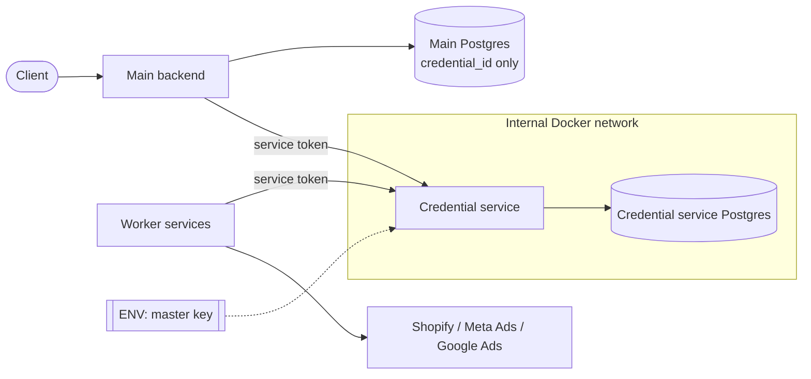
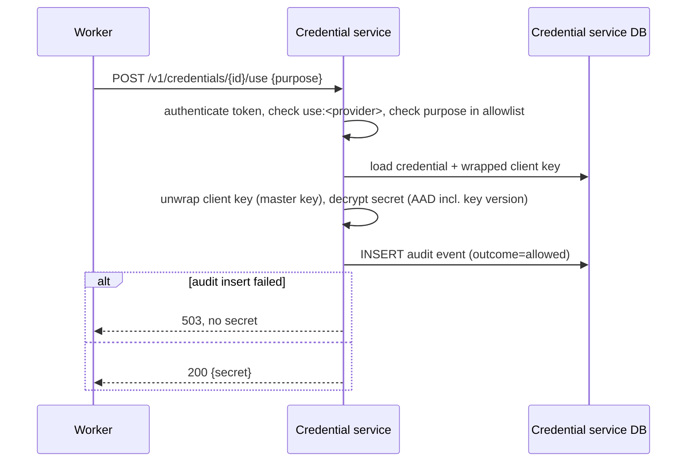
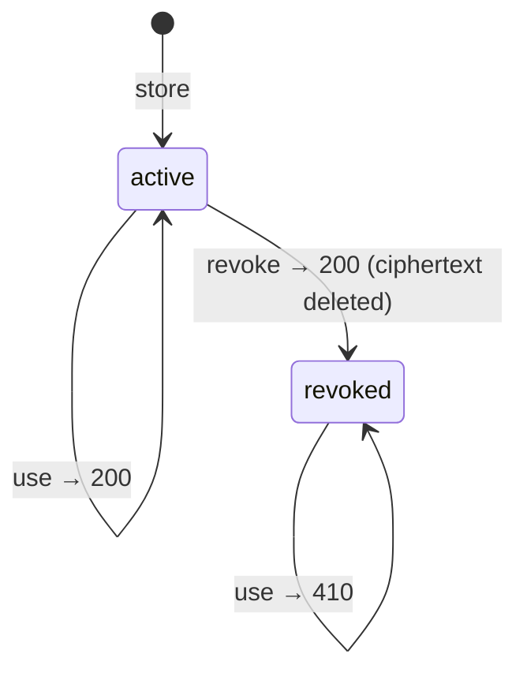
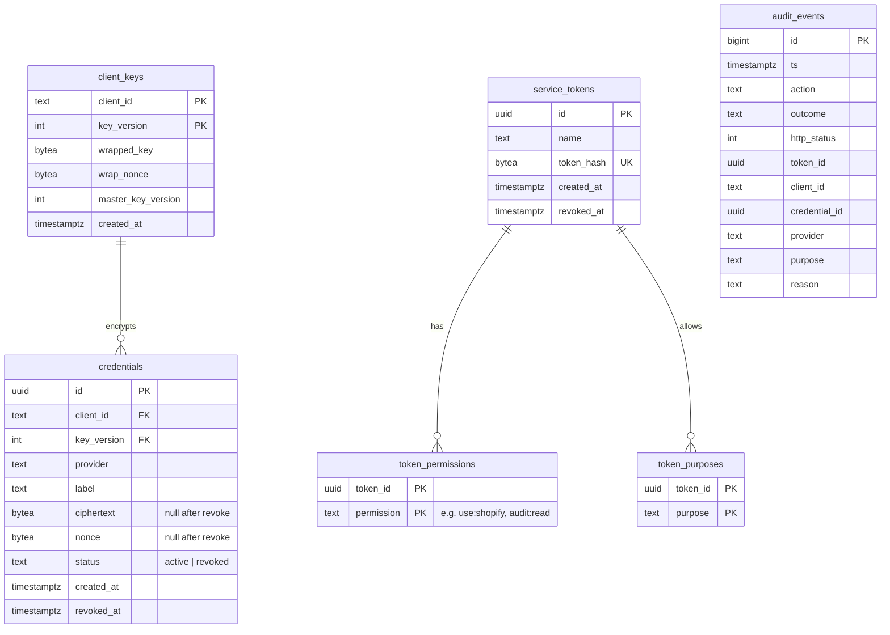

# Software Requirements Specification: Credential Service

Based on [problem.md](problem.md). Decisions beyond the owner's original list are recorded in [§13 Decision Log](#13-decision-log) and referenced as `D-n`. Implementation details live in [design.md](design.md).

## 1. Goals

| ID  | Goal                                                                                                                       |
| --- | -------------------------------------------------------------------------------------------------------------------------- |
| G-1 | A dump of the main database or of the credential service database alone does not reveal any client credential.             |
| G-2 | Compromise of a single client's encryption key reveals only that client's credentials.                                     |
| G-3 | Every access to a credential is recorded and can be shown to the owning client.                                            |
| G-4 | Internal services get credentials only for the actions and providers they are allowed to, and only for a declared purpose. |

## 2. Actors

| Actor          | Description                                                                                                                          |
| -------------- | ------------------------------------------------------------------------------------------------------------------------------------ |
| Main backend   | Stores credentials on client onboarding, revokes them, reads audit history to show it to clients.                                    |
| Worker service | Internal data collector or report/alert sender. Uses credentials to call provider APIs.                                              |
| Operator       | Engineer who deploys the credential service, sets the master key, issues service tokens with their permissions and allowed purposes. |
| Client         | Our customer (tenant). Never calls the credential service directly; sees history through the main backend.                           |

## 3. Context

## 4. Scenarios

### S-1 Store

Client connects a provider. Main backend calls `store`, receives `credential_id`, saves only the id in the main database.

### S-2 Use

Worker needs to call a provider API. It calls `use` with `credential_id` and one of its allowed purposes, receives the plaintext secret, uses it, does not persist it.

### S-3 Replace

Client re-issues a key. Main backend calls `store` with the new value, saves the new `credential_id`, then calls `revoke` on the old one. There is no update operation.

### S-4 Revoke

Client disconnects a provider. Main backend calls `revoke`. The ciphertext is deleted; further `use` returns `410`; repeated `revoke` returns `200` with status `revoked`.

### S-5 View history

Client opens the access log in our app. Main backend calls the audit endpoint for that client and renders the events.

### Credential lifecycle

## 5. Functional Requirements

### Store

- **FR-1** `store` accepts `client_id`, `provider` (`shopify` | `meta_ads` | `google_ads`), `secret`, optional `label`, and returns a new `credential_id` (UUID) with status `active`. (D-1, D-2)
- **FR-2** `store` rejects an unknown provider, an empty secret or a secret larger than the size limit (16 KiB, A-5) with `400`.
- **FR-3** On the first `store` for a `client_id`, the service generates a random 256-bit client key with `key_version = 1`, wraps it with the master key using AES-256-GCM and stores only the wrapped form. (D-3, D-6)
- **FR-4** The secret is encrypted with the client's key using AES-256-GCM with a unique nonce per encryption. The additional authenticated data is `credential_id`, `client_id` and the client key's `key_version`. (D-4, D-5)
- **FR-5** The credential service database never contains a plaintext secret or an unwrapped client key.
- **FR-6** Crypto uses only primitives from a standard, widely used library; no custom cryptographic algorithms. (D-7)

### Use

- **FR-7** `use` is the only operation that returns a plaintext secret.
- **FR-8** `use` requires `purpose`. A missing purpose returns `400`; a purpose not in the calling service's allowlist returns `403`. In both cases the secret is not returned. (D-8)
- **FR-9** `use` on an active credential with an allowed purpose returns `200` with the secret, `provider` and `client_id`. (D-9)
- **FR-10** `use` on a revoked credential returns `410`.
- **FR-11** `use` on an unknown `credential_id` returns `404`. (D-10)
- **FR-12** If the audit event for `use` cannot be written, `use` returns `503` and does not return the secret. (D-10)
- **FR-13** If decryption fails (tampered ciphertext, AAD mismatch including a changed `key_version`, wrong key), `use` returns `500` without the secret and the failure is audited. (D-10)

### Revoke

- **FR-14** `revoke` on an active credential sets status `revoked`, sets `revoked_at`, deletes ciphertext and nonce, and returns `200` with `{credential_id, status: "revoked", revoked_at}`. (D-11)
- **FR-15** `revoke` on an already revoked credential returns `200` with the same body; `revoked_at` keeps its original value. (D-11)
- **FR-16** Metadata of a revoked credential (id, client, provider, key version, timestamps) and its audit history are kept. (D-12)

### Audit history

- **FR-17** Reading audit history requires the `audit:read` permission. Only the main backend's service token is granted `audit:read`. (D-13)
- **FR-18** An audit history request must specify exactly one `client_id`; a request without it returns `400`. The response contains only events of that client. (D-13)
- **FR-19** Audit history supports optional filters `credential_id`, `from`, `to`, is ordered by time descending and paginated by cursor, max 100 events per page. (D-14)
- **FR-20** Audit events never contain secret values or service token values.

### Authentication and authorization

- **FR-21** Every endpoint except `/health` requires `Authorization: Bearer <service token>`; a missing or invalid token returns `401`. (D-15)
- **FR-22** Service tokens are stored only as SHA-256 hashes; the plaintext is shown once at issue time. (D-16)
- **FR-23** A service token has a set of permissions: `store:<provider>`, `use:<provider>`, `revoke:<provider>` and `audit:read`. A request outside the permissions returns `403`. (D-17)
- **FR-24** A service token has a list of allowed purposes, configured by the operator at issue time. (D-8)
- **FR-25** A revoked service token returns `401`. (D-15)

### Audit

- **FR-26** Every request to `store`, `use`, `revoke` and audit history produces exactly one audit event, including requests rejected with `400`, `401`, `403`, `404`, `410`. (D-18)
- **FR-27** An audit event contains: id, timestamp, action (`store` | `use` | `revoke` | `audit_read`), outcome (`allowed` | `denied` | `error`), HTTP status, service token id (null if unauthenticated), client_id, credential_id, provider, purpose (for `use`), reason for rejection. (D-18)
- **FR-28** Audit events are append-only: the application cannot update or delete them. (D-19)
- **FR-29** For `store` and `revoke`, the data change and the audit event are written in one transaction; if the audit insert fails, the change is rolled back and `503` is returned. (D-20)

### Startup

- **FR-30** The service refuses to start if the master key env variable is missing or is not 32 bytes after base64 decoding. (D-21)

## 6. Data Model

Main database stores only `credential_id` per client connection.

`audit_events` has no foreign keys so rejected requests with unknown ids or tokens can still be recorded. (D-18)

## 7. API

JSON over HTTP, prefix `/v1`, auth `Authorization: Bearer <token>`. (D-22)

| Method | Path                          | Body / query                                             | Success                                   | Permission          | Requirements |
| ------ | ----------------------------- | -------------------------------------------------------- | ----------------------------------------- | ------------------- | ------------ |
| POST   | `/v1/credentials`             | `{client_id, provider, secret, label?}`                  | `201 {credential_id}`                     | `store:<provider>`  | FR-1–FR-6    |
| POST   | `/v1/credentials/{id}/use`    | `{purpose}`                                              | `200 {secret, provider, client_id}`       | `use:<provider>`    | FR-7–FR-13   |
| POST   | `/v1/credentials/{id}/revoke` | `{reason?}`                                              | `200 {credential_id, status, revoked_at}` | `revoke:<provider>` | FR-14–FR-16  |
| GET    | `/v1/audit`                   | `client_id, credential_id?, from?, to?, cursor?, limit?` | `200 {events[], next_cursor}`             | `audit:read`        | FR-17–FR-20  |
| GET    | `/health`                     | —                                                        | `200 {status}`                            | —                   | —            |

Errors: `{error: {code, message}}`.

| Status | Meaning                                                                     |
| ------ | --------------------------------------------------------------------------- |
| 400    | Validation error, missing purpose                                           |
| 401    | Missing, invalid or revoked token                                           |
| 403    | Token lacks the required permission, or purpose not allowed for the service |
| 404    | Credential not found                                                        |
| 410    | `use` on a revoked credential                                               |
| 500    | Decryption failure                                                          |
| 503    | Audit could not be written                                                  |

## 8. Non-Functional Requirements

| ID    | Requirement                                                                                                                   |
| ----- | ----------------------------------------------------------------------------------------------------------------------------- |
| NFR-1 | `use` latency p95 ≤ 50 ms at 50 rps on a single instance. Measured over a 10-minute run with error rate < 0.1% (D-23).        |
| NFR-2 | Deployment: one service instance + one Postgres via Docker Compose.                                                           |
| NFR-3 | Neither the credential service nor its Postgres publishes ports to the host; reachable only from the internal Docker network. |
| NFR-4 | Credential service Postgres is a separate instance from the main database, with its own credentials.                          |
| NFR-5 | Master key is read from an environment variable only; never written to the database, logs or responses.                       |
| NFR-6 | Application logs never contain secret values, client keys, master key or service token values. (D-24)                         |
| NFR-7 | The credential service application connects to Postgres with a least-privilege role that cannot change the schema. (D-19)     |

## 9. Threat Model

| Threat                                                       | Mitigation                                                                                    | Residual risk                            |
| ------------------------------------------------------------ | --------------------------------------------------------------------------------------------- | ---------------------------------------- |
| Main DB dump or restore to staging                           | Main DB holds only `credential_id`                                                            | None for secrets                         |
| Credential service DB dump or restore to staging             | Secrets encrypted with client keys; client keys wrapped by a master key that is not in the DB | None without the master key              |
| One client key leaked                                        | Per-client keys                                                                               | That client's credentials exposed        |
| Master key leaked together with a credential service DB dump | Master key only in env; KMS planned                                                           | All credentials exposed                  |
| Stolen service token                                         | Scoped permissions, purpose allowlist, revocable tokens, every use audited                    | Abuse within token scope until revoked   |
| Compromised internal service                                 | Same as stolen token                                                                          | Secrets it legitimately uses are exposed |
| Audit tampering by the application                           | Append-only enforced in the database                                                          | DB superuser can still modify            |
| Ciphertext swapped between credentials or key versions       | AAD binds ciphertext to `credential_id`, `client_id`, `key_version`                           | None                                     |
| Network sniffing                                             | Internal Docker network only                                                                  | Plain HTTP inside the network (OQ-4)     |

## 10. Assumptions

- **A-1** `client_id` is an opaque identifier owned by the main backend; the credential service does not validate it.
- **A-2** Service tokens, their permissions and allowed purposes are issued and revoked by the operator via CLI; there is no token management API.
- **A-3** Callers do not cache or persist secrets returned by `use`.
- **A-4** All callers run inside the same internal Docker network.
- **A-5** A secret size limit of 16 KiB covers all provider tokens in use.
- **A-6** The main backend shows each client only that client's history; clients never receive data for other `client_id`s.

## 11. Out of Scope

- Updating a credential in place.
- Direct client access to the credential service.
- KMS integration (master key stays in env for now).
- High availability, multiple instances, replication.
- Custom cryptography.
- Refreshing or validating tokens against Shopify / Meta / Google APIs. (D-25)
- Migration of existing credentials from the main database. (D-25)
- UI. (D-25)

## 12. Acceptance Criteria

| ID    | Given                                                                                                 | When                                                                 | Then                                                                                                                    | Covers              |
| ----- | ----------------------------------------------------------------------------------------------------- | -------------------------------------------------------------------- | ----------------------------------------------------------------------------------------------------------------------- | ------------------- |
| AC-1  | Token with `store:shopify`                                                                            | `POST /v1/credentials` with a valid shopify secret                   | `201` with UUID; row in `credentials` has status `active`, `key_version = 1`, ciphertext ≠ secret bytes                 | FR-1, FR-4, FR-5    |
| AC-2  | Token with `store:shopify`                                                                            | Store with provider `tiktok`, empty secret, 17 KiB secret            | `400` each; one `denied` audit event each                                                                               | FR-2, FR-26         |
| AC-3  | New `client_id`                                                                                       | Two credentials stored for it                                        | Exactly one row in `client_keys`; full DB dump contains no plaintext secret                                             | FR-3, FR-5          |
| AC-4  | Same secret stored twice                                                                              | Compare rows                                                         | Nonces and ciphertexts differ                                                                                           | FR-4                |
| AC-5  | Active credential, token with `use:shopify` and allowed purpose `daily_report`                        | `use` with purpose `daily_report`                                    | `200` with the original secret; `allowed` audit event with purpose                                                      | FR-7, FR-9, FR-27   |
| AC-6  | Same setup as AC-5                                                                                    | `use` without purpose                                                | `400`, no secret, `denied` audit event                                                                                  | FR-8, FR-26         |
| AC-6a | Same setup as AC-5                                                                                    | `use` with purpose `export`, which is not in this token's allowlist  | `403`, no secret, `denied` audit event                                                                                  | FR-8, FR-24, FR-26  |
| AC-7  | Active credential, audit insert made to fail                                                          | `use`                                                                | `503`, response body has no secret                                                                                      | FR-12               |
| AC-8  | Ciphertext of credential A copied into credential B's row; separately, `key_version` of a row changed | `use` on each                                                        | `500`, no secret, `error` audit event                                                                                   | FR-4, FR-13         |
| AC-9  | Active credential                                                                                     | `revoke`, `revoke`, then `use`                                       | `200 {status: "revoked"}` twice with equal `revoked_at`, then `410`; ciphertext and nonce are null; metadata row exists | FR-10, FR-14–FR-16  |
| AC-10 | Unknown `credential_id`                                                                               | `use`                                                                | `404`, `denied` audit event                                                                                             | FR-11, FR-26        |
| AC-11 | No token / invalid token / revoked token                                                              | Any endpoint except `/health`                                        | `401`; audit event with null token id for unknown tokens                                                                | FR-21, FR-25, FR-26 |
| AC-12 | Token with only `use:shopify`                                                                         | `use` on a `google_ads` credential; `store` shopify; `GET /v1/audit` | `403` each; `denied` audit events                                                                                       | FR-17, FR-23, FR-26 |
| AC-13 | Token issued via CLI                                                                                  | Inspect `service_tokens`                                             | Only the SHA-256 hash is stored; plaintext not found in DB                                                              | FR-22               |
| AC-14 | Clients A and B with events, token with `audit:read`                                                  | `GET /v1/audit?client_id=A`; `GET /v1/audit` without `client_id`     | First: only A's events, newest first, ≤ 100 per page, `next_cursor` works, no secrets; second: `400`                    | FR-18–FR-20         |
| AC-15 | Application's DB connection                                                                           | `UPDATE` / `DELETE` on audit events; `ALTER TABLE` on any table      | All fail                                                                                                                | FR-28, NFR-7        |
| AC-16 | Audit insert made to fail                                                                             | `store`; `revoke`                                                    | `503`; no new credential row; revoked credential stays `active`                                                         | FR-29               |
| AC-17 | Master key env missing or 16 bytes                                                                    | Start service                                                        | Process exits with non-zero code                                                                                        | FR-30               |
| AC-18 | Running stack                                                                                         | Load test `use` at 50 rps for 10 min                                 | p95 ≤ 50 ms, errors < 0.1%                                                                                              | NFR-1               |
| AC-19 | `docker-compose.yml`                                                                                  | Inspect the credential service and its Postgres services             | No `ports` section; Postgres is separate from the main DB                                                               | NFR-2–NFR-4         |
| AC-20 | Full test suite run with known secrets and tokens                                                     | Grep application logs                                                | No secret, key or token value found                                                                                     | NFR-5, NFR-6        |

## 13. Decision Log

Decisions made beyond the owner's original list. Status: **Accepted** — confirmed as proposed; **Changed** — confirmed with a change by the owner.

| ID   | Decision                                                                                                                                                                                             | Status   | Why                                                                                                             | Where             |
| ---- | ---------------------------------------------------------------------------------------------------------------------------------------------------------------------------------------------------- | -------- | --------------------------------------------------------------------------------------------------------------- | ----------------- |
| D-1  | Provider identifiers are fixed strings `shopify`, `meta_ads`, `google_ads`; `label` is optional free text.                                                                                           | Accepted | Closed set of supported integrations; label helps humans tell credentials apart.                                | FR-1              |
| D-2  | `credential_id` is a UUID generated by the credential service.                                                                                                                                       | Accepted | Not guessable, no coordination with the main DB needed.                                                         | FR-1              |
| D-3  | The client key is 256-bit random, created on the first `store` for a client, starting at `key_version = 1`.                                                                                          | Accepted | AES-256 key size; no separate onboarding call needed.                                                           | FR-3              |
| D-4  | "Key version" in AAD is the client key's `key_version`; the master key version is stored separately.                                                                                                 | Accepted | The client key encrypts the secret, so its version is what must be bound to the ciphertext.                     | FR-4              |
| D-5  | AAD is an unambiguous encoding of `credential_id`, `client_id`, `key_version`; a unique nonce per encryption. Details: [design.md §4](design.md#4-cryptography).                                     | Accepted | Unambiguous encoding prevents field-boundary collisions; nonce reuse breaks GCM.                                | FR-4              |
| D-6  | Wrapping the client key also uses AES-256-GCM, with `client_id`, `key_version`, `master_key_version` as AAD.                                                                                         | Accepted | One algorithm everywhere; a wrapped key cannot be moved to another client.                                      | FR-3              |
| D-7  | Crypto uses a standard, widely used library. Details: [design.md §4](design.md#4-cryptography).                                                                                                      | Accepted | Follows "no custom crypto".                                                                                     | FR-6              |
| D-8  | Allowed purposes are attached to a service token (one service = one token), exact case-sensitive match, configured via CLI. Missing purpose → `400`; purpose not in the service's allowlist → `403`. | Changed  | Owner: a well-formed request with a forbidden purpose is an authorization failure, not a validation error.      | FR-8, FR-24       |
| D-9  | `use` response also returns `provider` and `client_id`.                                                                                                                                              | Accepted | Lets the caller verify it got the credential it expected.                                                       | FR-9              |
| D-10 | `404` for unknown credential, `500` for decryption failure, `503` for audit failure.                                                                                                                 | Accepted | Distinguishes caller errors, data integrity failures and temporary unavailability.                              | FR-11–FR-13       |
| D-11 | First and repeated `revoke` both return `200` with the same body; repeated revoke keeps the original `revoked_at` and is audited as `allowed`.                                                       | Accepted | Idempotent revoke is safe to retry; one response shape for callers.                                             | FR-14, FR-15      |
| D-12 | Revoke deletes ciphertext and nonce; metadata and audit history are kept (retention: OQ-5).                                                                                                          | Accepted | Nothing to decrypt after revoke; history must stay visible to the client.                                       | FR-16             |
| D-13 | `audit:read` is not limited to specific tenants; one client per request. Only the main backend's token holds `audit:read`, and the backend shows each client only its own history.                   | Accepted | Only one trusted reader; tenant isolation for end users is enforced by the backend.                             | FR-17, FR-18, A-6 |
| D-14 | History filters, descending order, cursor pagination, max 100 per page.                                                                                                                              | Accepted | Covers the client-facing access log; cursor is stable under inserts.                                            | FR-19             |
| D-15 | `/health` requires no token; revoked tokens return `401`, not `403`.                                                                                                                                 | Accepted | Health checks from Docker; a revoked token is no longer a valid identity.                                       | FR-21, FR-25      |
| D-16 | Tokens are hashed with SHA-256; plaintext shown once.                                                                                                                                                | Accepted | Tokens are high-entropy random values, so a slow hash adds latency without benefit.                             | FR-22             |
| D-17 | Permission format `<action>:<provider>` for credential actions, `audit:read` for history.                                                                                                            | Accepted | One readable string format, matches the owner's `audit:read`.                                                   | FR-23             |
| D-18 | Audit event field set; history reads audited as `audit_read`; unauthenticated requests audited with a null token id; no foreign keys on audit.                                                       | Accepted | "Every action is audited" includes reads and rejected requests with unknown ids.                                | FR-26, FR-27      |
| D-19 | Append-only audit enforced in the database; least-privilege app role. Details: [design.md §6](design.md#6-database).                                                                                 | Accepted | Enforcement must not depend on application code being correct.                                                  | FR-28, NFR-7      |
| D-20 | `store` and `revoke` also require a successful audit write in the same transaction.                                                                                                                  | Accepted | Otherwise a change could happen without a trace.                                                                | FR-29             |
| D-21 | Master key: 32 bytes, base64, in an env variable; startup fails otherwise.                                                                                                                           | Accepted | Fail fast instead of running with a wrong key.                                                                  | FR-30             |
| D-22 | REST/JSON, `/v1` prefix, `use` and `revoke` as `POST`, error body `{error: {code, message}}`.                                                                                                        | Accepted | `use` has side effects (audit) and a body; versioned API.                                                       | §7                |
| D-23 | NFR-1 measured over a 10-minute run with error rate < 0.1%.                                                                                                                                          | Accepted | Makes the latency target reproducible.                                                                          | NFR-1             |
| D-24 | Logs never contain secrets, keys or tokens.                                                                                                                                                          | Accepted | Logs are a common leak path.                                                                                    | NFR-6             |
| D-25 | Out of scope: provider token refresh/validation, migration of existing credentials, UI.                                                                                                              | Accepted | Keeps the first version to store / use / revoke / history.                                                      | §11               |
| D-26 | Assumptions A-1–A-4.                                                                                                                                                                                 | Accepted | Boundaries the credential service relies on but does not enforce.                                               | §10               |
| D-27 | If the audit write fails for a request that is already rejected (`400`/`401`/`403`/`404`/`410`), the response keeps its original status and the audit failure is logged.                             | Accepted | The caller gets no secret either way; turning a rejection into `503` would hide the real reason. Resolves OQ-7. | FR-26             |

## 14. Open Questions

| ID   | Question                                                                                                                                                                                                                                        |
| ---- | ----------------------------------------------------------------------------------------------------------------------------------------------------------------------------------------------------------------------------------------------- |
| OQ-1 | Who refreshes expiring OAuth tokens (Meta, Google)? Per the decisions, refresh = store new + revoke old; which service does it?                                                                                                                 |
| OQ-2 | How are service tokens issued and rotated in practice (CLI on the host, separate admin token, other)?                                                                                                                                           |
| OQ-3 | Master key rotation and client key rotation: needed before KMS, or deferred?                                                                                                                                                                    |
| OQ-4 | Is plain HTTP inside the internal Docker network acceptable, or is TLS / mTLS required?                                                                                                                                                         |
| OQ-5 | Audit retention period and whether history must survive client offboarding.                                                                                                                                                                     |
| OQ-6 | Client offboarding: should the client key be destroyed (crypto-shredding) when a client leaves?                                                                                                                                                 |
| OQ-7 | ~~If the audit write fails for a request that is already being rejected (`400`/`401`/`403`/`404`/`410`), should the response stay the same or become `503`?~~ **Resolved:** the original status is kept and the audit failure is logged (D-27). |
| OQ-8 | Availability target and backup/restore procedure for the credential service DB, including restore to non-production environments.                                                                                                               |
| OQ-9 | How are existing credentials migrated from the main database: re-issued by clients or imported?                                                                                                                                                 |
